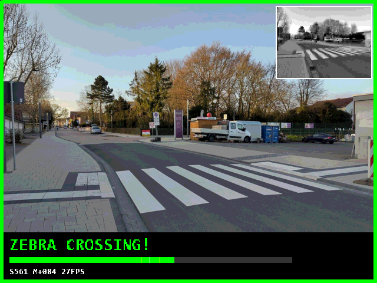
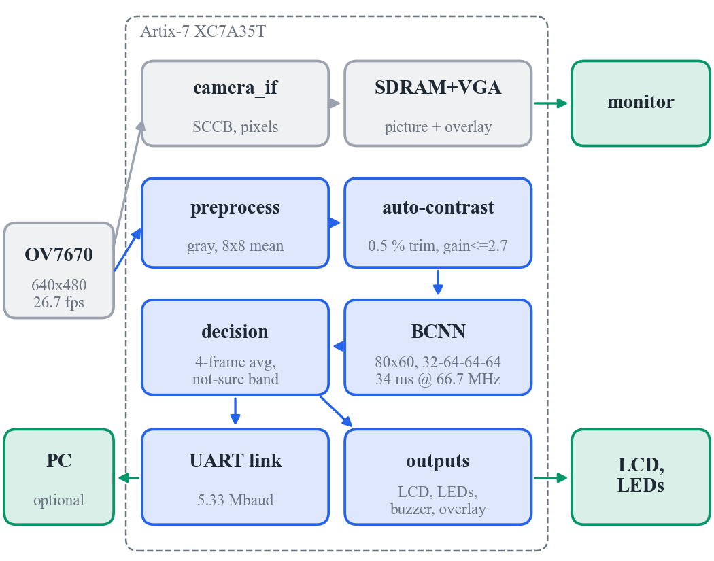

# Live Zebra-Crossing Detection on an FPGA Camera

An **OV7670 camera** and a **1-bit (binarized) convolutional neural network**,
both handled entirely in hand-written Verilog on a low-cost **Artix-7 FPGA**.
Every camera frame is checked in **34 ms**, the whole design draws about
**0.29 W**, and the answer, **ZEBRA CROSSING / NOT SURE / NO CROSSING**, appears
live on a VGA monitor, a 16×2 LCD, LEDs and a buzzer.

No processor, no operating system, no GPU, no internet, and no multipliers in the network.



*Monitor output: the green border means "crossing", the inset at the top right
is the 80×60 image the network sees, and the banner shows the decision, a score
bar and the frame rate. (Frame rendered by RTL simulation of the VGA path, with
a street photo as the camera input.)*

---

## At a glance

| | |
|---|---|
| **Live detection** | every OV7670 frame (26.7 fps) is analysed: 34.0 ms per inference at 66.7 MHz |
| **Power** | about 0.29 W for the whole FPGA design (Vivado estimate); the network core itself 22 mW |
| **Energy per decision** | about 11 mJ, **27× less** than a published crosswalk detector on a Jetson Nano (302 mJ) |
| **Network** | 80×60 gray → 4 binary conv layers (32-64-64-64) → 1 score; 93,408 one-bit weights (11.4 KB), all on chip |
| **Accuracy** | 79.4 % on 524 dashcam frames (T1), 79.1 % on 115 street photos (T2); when it answers instead of "not sure": **90.2 % / 95.7 %** |
| **Camera robustness** | hardware auto-contrast: on dull, camera-like images 47.7 → 78.2 % (T1) and 67.0 → 78.3 % (T2) |
| **FPGA use** | 3,370 LUTs (16 %), 2,730 FFs, 19 of 50 BRAMs, 1 DSP, 1 MMCM on an XC7A35T |
| **Verified on hardware** | 639 / 639 test images bit-exact on the real board against the Python golden model; board self-test ALL PASS |

---

## Why this design

**Real time, every frame.** The network needs a fixed 2,269,477 clock cycles
per image: 34.0 ms at 66.7 MHz, shorter than the camera's 37.5 ms frame time.
There is no operating system or scheduler, so the latency is the same for every frame.

**Very little energy.** The design runs the whole camera-to-decision chain on
one small chip:

| Platform | Power | Energy per decision |
|---|---|---|
| **This design** (Artix-7 FPGA, whole camera system) | 0.29 W | **≈ 11 mJ** |
| CDNet on a Jetson Nano GPU board | 10 W | ≈ 302 mJ |
| The same 1-bit network on a laptop CPU (i5-12500H) | 45 W | ≈ 366 mJ |
| ResNet-18 on the same laptop CPU | 45 W | ≈ 1,900 mJ |

<sub>Energy = power × time per decision. FPGA: Vivado power estimate.
Jetson Nano: figures from the CDNet paper. Laptop: 45 W processor power × measured time.</sub>

**No multipliers.** Weights and activations are +1 or −1, stored as single
bits. A multiplication becomes "same or different?", which is an XNOR gate,
and a sum becomes a count of ones (popcount). One clock cycle compares 64
channels at once using a few LUTs. BatchNorm and the sign function fold into one integer
threshold per neuron, and 2×2 max-pooling is an OR of four bits.

**Fits a small, cheap FPGA.** The complete system, including camera, SDRAM, VGA,
LCD and UART, uses 16 % of the XC7A35T's logic. All weights sit in on-chip block RAM.

**Honest answers.** When the score is close to the threshold the system says
**NOT SURE** instead of guessing. The answers it does give are 90–96 % correct.

**Built for a real camera.** The OV7670's pictures are flat and washed out,
which cut the network's accuracy to 47.7 %. A per-frame auto-contrast block in
hardware restores about 78 % and takes 0.15 ms.

**Verified bit for bit.** A Python golden model computes exactly what the hardware
computes. RTL simulation matches it on every image and every intermediate
feature map, and the real board matches it on all 639 test images.

---

## How live detection works



```
OV7670 ──┬──> camera_interface ─> SDRAM ─> VGA picture ──────────┐   live picture
         │                         └─> photo capture ─> UART     │
         │                                                       │
         └──> cam_preproc: RGB565 -> gray -> 8x8 mean -> 80x60   │   detection path
                 └─> frame buffer ─> auto-contrast ─> BCNN ──────┤   (independent of SDRAM)
                                                └─> decision ────┴─> VGA overlay, LCD,
                                                                     LEDs, buzzer, UART
```

1. **Camera.** The OV7670 sends 640×480 RGB565 frames at 26.7 fps. The FPGA
   configures it over SCCB at power-up.
2. **Preprocessing** (`rtl/vision/cam_preproc.v`) listens to the camera pins in
   parallel with the picture path. It converts each pixel to gray with
   `(77R + 150G + 29B) >> 8`, exactly as in training, and sums 8×8 blocks into an
   80×60 image (sum and shift, no divider). The results alternate between two
   frame-buffer banks. A frame is used only if all 480 lines are complete.
3. **Auto-contrast** (`rtl/vision/bcnn_engine.v`) builds a histogram per frame,
   finds the darkest and brightest 0.5 % (so a lamp in view does not defeat it), and
   stretches the image with the gain capped at 2.7× (so flat walls are not blown up
   into stripe-like texture).
4. **BCNN core** (`rtl/bcnn/bcnn_core.v`) is one reusable engine that runs all five layers in turn,
   one kernel tap per clock (64-channel XNOR + popcount), in a 3-stage pipeline.
   Its layer table, weights and thresholds are generated by Python, so the model
   and the hardware cannot drift apart.
5. **Decision.** The margin (score − 477) is averaged over 4 frames. A margin
   of −31 ≤ margin < 33 means NOT SURE. If no camera result arrives for 1 s,
   the display shows WAITING.
6. **Outputs:** a VGA overlay on the live picture, the LCD, the LEDs, the buzzer,
   and a 5.33 Mbaud UART link to an optional PC tool.

**Clocks** (`rtl/io/clk_rst.v`): a single MMCM generates 133.33 MHz (camera, SDRAM, UART),
66.7 MHz (BCNN), 25 MHz (VGA) and 21.33 MHz (camera XCLK). Every clock-domain
crossing is a dual-clock BRAM or a toggle/level handshake, and timing is met on all clocks.

| Layer | Operation | Output |
|---|---|---|
| Input | gray image, 8-bit | 80×60 |
| L1 | 3×3 conv, 32 filters, binary weights on 8-bit pixels | 40×30×32 |
| L2 | 3×3 conv, 64, XNOR-popcount | 20×15×64 |
| L3 | 3×3 conv, 64, XNOR-popcount | 10×7×64 |
| L4 | 3×3 conv, 64, XNOR-popcount | 5×3×64 |
| Output | fully connected, 960 → 1 | score 0–960 |

Every conv layer applies its threshold and then a 2×2 max-pool. The network was
trained in PyTorch with a straight-through estimator and distillation from a
ResNet-18 teacher, on about 11,000 images from 14 sources.

---

## Results

| Test set | All pictures | When it answers | Share answered |
|---|---|---|---|
| T1: 524 dashcam frames | 79.4 % | 90.2 % | 51 % |
| T2: 115 street photos (unseen photographers) | 79.1 % | 95.7 % | 40 % |

On the real board (EDGE Artix-7 + OV7670):

| Check | Result |
|---|---|
| `zebracam.py auto selftest` | ALL PASS (8 / 8) |
| Camera | 640 × 480 frames, 0 rejected |
| Network on the camera | every frame analysed, 0 skipped |
| T2 through the FPGA (`hil vectors/t2`) | 115 / 115 bit-exact, 79.13 % |
| T1 through the FPGA (`hil vectors/t1`) | 524 / 524 bit-exact, 79.39 % |
| VGA, LCD, LEDs | live picture and overlay, decision and LEDs as specified |

The full results are in [docs/RESULTS.md](docs/RESULTS.md): timing, robustness to camera effects,
the auto-contrast variants and the model comparison. The paper and the slides are in
[docs/paper/](docs/paper/) and [docs/](docs/).

---

## Running it on the board

**You need:** an EDGE Artix-7 board, an OV7670 on the camera header, a VGA monitor,
a USB cable (programming and UART on the same cable), Vivado 2024.2, and
Python 3 with `pip install pyserial numpy pillow opencv-python`.

1. **Switches:** set all switches **down** except **M6 (sw15) up**. M6 up means run, down means reset.
2. **Buzzer:** put jumper **J6 on "Enable"** if you want the beep.
3. **Program:** run `program.bat`, or
   `vivado -mode batch -source vivado/program.tcl -tclargs bitstream/zebracam.bit`.
   This loads the design over JTAG and then runs the self-test.
4. **Self-test:** `python host/zebracam.py auto selftest` should end with
   `ALL PASS - the system is working`. Each FAIL line says what to check.
5. **Focus the lens** until the monitor picture is sharp. Blur costs the network
   more accuracy than any lighting change.
6. **Point the camera at a zebra crossing**, or at a large printed photo or screen
   that fills the view. LED 0 lights, the border turns green, the LCD shows
   `ZEBRA CROSSING!` and the buzzer beeps.

### What you see

**VGA monitor (640×480):** the live camera picture with
- **a coloured border:** green = ZEBRA CROSSING, yellow = NOT SURE, red = NO CROSSING, grey = waiting for the camera.
- **top right:** the 80×60 image the network sees, after auto-contrast.
- **bottom banner:** the decision, a score bar (white mark = threshold, yellow marks = the not-sure band) and `S<score> M<margin> <n>FPS`.

**LCD 16×2:** the decision on line 1, and `S561 M+084 26FPS` (score, margin, inferences per second) on line 2.

| LED | Meaning |
|---|---|
| **0** | **ZEBRA CROSSING** |
| 1 | NOT SURE |
| 2 | NO CROSSING |
| 3 | camera configured over SCCB |
| 4 | camera frames arriving (blinks) |
| 5 | BCNN computing |
| 6 | UART busy |
| 7 | heartbeat |
| **8–15** | confidence meter: fills from LED 8 as the network becomes surer there is a crossing |

| Switch | Down (0) | Up (1) |
|---|---|---|
| sw4 | crossing / not sure / no crossing | plain yes / no |
| sw5 | average over 4 frames | every frame on its own |
| sw6 | buzzer on | buzzer muted |
| sw7 | overlay on | camera picture only |
| sw8 | auto-contrast on | raw camera picture to the network |
| sw15 (M6) | reset | run |
| centre button | | send a full 640×480 photo to the PC |

### PC tool (optional)

```
python host/zebracam.py auto selftest              # check everything (COM port found automatically)
python host/zebracam.py auto live                  # live window: network view, answer, margin plot
python host/zebracam.py auto photo a.jpg b.jpg     # classify photos on the FPGA, compare with the golden model
python host/zebracam.py auto hil vectors/t2        # the 115 T2 street photos on the FPGA: accuracy + bit-exact check
python host/zebracam.py auto hil vectors/t1        # the 524 T1 dashcam frames
python host/zebracam.py auto snapshot net.png      # what the network sees now
python host/zebracam.py auto capture photo.png     # full-resolution camera photo
python host/zebracam.py fake selftest              # the same tool against a software model (no board)
```

### Troubleshooting

| Symptom | Fix |
|---|---|
| no FPGA answers on any COM port | program the board, set M6 up, check the USB cable |
| self-test: camera configured FAIL | re-seat the OV7670, check 3.3 V, press reset (M6 down, then up) |
| noise or stripes everywhere, geometry OK | the camera missed its setup at power-up: press reset |
| monitor shows tearing, detector works | program the fallback `bitstream/zebracam_proven.bit` |
| always NOT SURE or wrong | focus the lens, fill the view with the scene, set sw8 down; then fine-tune (below) |
| picture upside down | rotate the camera: the network expects the sky at the top |
| LCD blank / no beep | turn the LCD contrast potentiometer / set J6 to Enable and sw6 down |

---

## Building and simulating

**Vivado GUI:** Tools → *Run Tcl Script…* → `vivado/create_project.tcl`, then
Run Synthesis → Run Implementation → Generate Bitstream.

**Command line:**
```
vivado -mode batch -source vivado/build.tcl -tclargs iob 12 bit      # default build (BCNN at 66.7 MHz)
vivado -mode batch -source vivado/build.tcl -tclargs proven 12 bit   # fallback SDRAM placement
```

**Keeping the design after power-off:** in Hardware Manager, add the board's SPI
flash as a configuration memory device and program `bitstream/zebracam.bin`.

**Simulation** (Vivado xsim, each script prints PASS / FAIL):

| Script | What it checks |
|---|---|
| `python sim/check_preproc.py` | camera pins → 80×60 image, bit-exact; broken frames are rejected |
| `python sim/check_vision.py` | camera model + serial PC → preprocessing, auto-contrast, BCNN, decision, every UART command, including a real OV7670 frame |
| `python sim/check_display.py --state 2 --camera` | renders a VGA frame to a PNG and decodes the LCD bus |
| `python sim/check_host_replay.py` | the PC tool parses the exact bytes the RTL sent |
| `python sim/check_top.py` | the whole design: MMCM, resets, UART sharing, LEDs |

---

## Adapting to a new scene

A model trained on street photos can be tuned to a specific scene (a lab, a
model road, printed photos) with about 15 minutes of data:

```
python host/zebracam.py auto live --save data/cam      # press z on crossings, n on everything else
python python/finetune_camera.py data/cam/camera_set.npz
```

`finetune_camera.py` mixes the new frames with the original training images,
holds out 20 % for testing, and reports camera, T1 and T2 accuracy before and after.
Copy the new ROM files into `mem/`, rebuild and program.

Training from scratch uses our separate training repository
(`zebra-crossing-bcnn-fpga`). The scripts in `python/` that retrain or re-evaluate
models expect it next to this folder. Everything needed to run, rebuild and
verify the hardware is in this repository.

---

## Repository layout

```
rtl/top.v              top level: pins, clocks, UART sharing, LEDs
rtl/vision/            cam_preproc, bcnn_engine (auto-contrast, decision), uart_link
rtl/bcnn/bcnn_core.v   the binarized CNN engine
rtl/io/                MMCM clocks, CDC, BRAM, VGA overlay, status text, LCD, buzzer
rtl/camera/            OV7670, SDRAM, VGA and photo-capture modules
mem/                   deployed model: weights, thresholds, layer table, decision band, golden vectors, font
models/                v3 (deployed), v3c and v3cs models with their ROM files
bitstream/             ready-to-program bitstreams (default, fallback, v3c)
vectors/               T1 / T2 test sets as FPGA input + golden answers
host/                  PC tool (zebracam.py) and full-resolution photo capture
python/                golden camera model, robustness study, fine-tuning, figures
sim/                   testbenches and check scripts
vivado/                project and build scripts, constraints
demo_photos/           street photos for demos (Wikimedia Commons; licences in SOURCES.tsv)
docs/                  results, paper, slides, figures
```

---

## Authors

**Raj Mali** and **Pooja Nagvekar**, guided by **Prof. Anuradha Joshi** and
**Prof. Amaya Pethe**, Vidyalankar Institute of Technology, Mumbai.

Demo photos are from Wikimedia Commons under the licences listed in
`demo_photos/SOURCES.tsv`. The T1 test set is from CDSet (Zenodo record 8289874).
